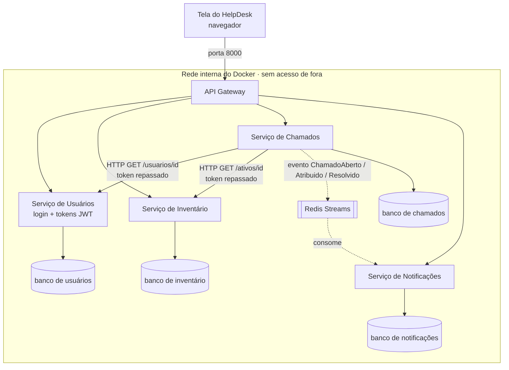

# HelpDesk TI · microsserviços

> 🎥 **Vídeo de demonstração:** _cole aqui o link do YouTube (não listado) ou do Google Drive_

Sistema de chamados de TI (no estilo de um GLPI simplificado) que começou como um **monólito**
([helpdesk-ti](https://github.com/prof-filipecavalcante/helpdesk-ti)) e foi separado em **microsserviços**
na atividade de **Arquitetura de Software** (Prof. Filipe Cavalcante). Todas as funcionalidades
do monólito continuam: login, equipamentos, chamados com SLA, atribuição, status, comentários, painel e notificações.

## Arquitetura



Linhas contínuas são chamadas síncronas (HTTP); linhas tracejadas são **eventos assíncronos** (o bônus).

| Serviço | Responsabilidade | Banco próprio | Fala com |
|---|---|---|---|
| **gateway** | Único ponto de entrada (porta 8000): serve a tela, encaminha as rotas e mostra a saúde dos serviços | — | todos os serviços |
| **usuarios** | Cadastro de usuários, **login e emissão dos tokens JWT** | `usuarios-dados` | — |
| **inventario** | Equipamentos (computadores, impressoras...) | `inventario-dados` | — |
| **chamados** | Chamados, SLA, status, comentários e painel | `chamados-dados` | Usuários e Inventário (HTTP), Redis (eventos) |
| **notificacoes** _(bônus)_ | Grava os avisos a partir dos eventos | `notificacoes-dados` | Redis (lê eventos) |
| redis | Fila de eventos | `redis-dados` | — |

### Mapa de rotas (todas pelo gateway, `http://localhost:8000`)

| Rota | Serviço |
|---|---|
| `/auth/*`, `/usuarios*` | Usuários |
| `/ativos*` | Inventário |
| `/chamados*` | Chamados |
| `/notificacoes` | Notificações |
| `/saude` | Gateway (mostra quais serviços estão no ar) |
| `/`, `/app.js`, `/estilo.css` | Tela |

Cada serviço também tem o seu próprio `GET /saude`.

## Como rodar

```bash
docker compose up --build
```

Não precisa de nenhum ajuste: o segredo dos tokens é criado sozinho na primeira subida
(ou use o seu: `cp .env.example .env` e defina `JWT_SEGREDO`). Depois abra **http://localhost:8000**.

```bash
docker compose ps                     # todos os contêineres (healthy)
docker compose logs -f chamados       # logs de um serviço
docker compose down                   # para tudo (os bancos continuam nos volumes)
docker compose down -v                # para tudo E apaga os bancos e o segredo
```

### Contas de acesso

Todas usam a senha **`Helpdesk2026`** (mude com `SENHA_EXEMPLO` no `.env`, antes da primeira subida).

| E-mail | Perfil | O que pode fazer |
|---|---|---|
| `admin@empresa.com` | Administrador | Tudo, inclusive cadastrar usuários |
| `carla@empresa.com` | Técnica | Ver todos os chamados, atribuir, resolver e cadastrar equipamentos |
| `diego@empresa.com` | Técnico | O mesmo que a Carla |
| `ana@empresa.com` | Solicitante | Abrir chamados e ver só os próprios |
| `bruno@empresa.com` | Solicitante | O mesmo que a Ana |

### Testando a falha de um serviço

```bash
docker compose stop inventario    # a tela mostra o Inventário "vermelho" no topo
# - listar usuários e chamados continua funcionando
# - abrir chamado COM equipamento -> erro 503 claro ("serviço de Inventário indisponível")
# - abrir chamado SEM equipamento continua funcionando
docker compose start inventario   # volta ao normal (o disjuntor libera em até 10 s)
```

O mesmo vale para `usuarios` (não dá para entrar nem atribuir, mas os chamados aparecem) e
`notificacoes` (os chamados continuam sendo abertos; os avisos chegam quando ele voltar).

### Teste de fumaça

Com tudo no ar, `python scripts/teste_fumaca.py` percorre o fluxo completo pelo gateway
(login, 401 sem token, permissões, abrir → atribuir → resolver → fechar).

## Testes

Cada serviço tem os seus próprios testes e roda sozinho:

```bash
cd usuarios && pip install -r requirements-dev.txt && pytest -q   # idem: inventario, chamados, notificacoes, gateway
```

Os testes de **segurança** (token falso, vencido, `alg: none`, perfil inventado, permissões, campos extras, limites de
tamanho) existem em **cada serviço**, e os de **resiliência** (timeout, 503, disjuntor, fila fora do ar) ficam em
`chamados/tests/test_resiliencia.py`. O GitHub Actions roda uma matriz com um job por serviço + `pip-audit`.

## Decisões de arquitetura

1. **Um serviço por responsabilidade, cada um um projeto.** `usuarios/`, `inventario/`, `chamados/`, `notificacoes/` e `gateway/` têm
   o seu `Dockerfile`, `requirements.txt` e testes. Comecei separando Usuários (não depende de ninguém), depois Inventário,
   depois Chamados (que depende dos dois), conforme o histórico de commits.
2. **Banco por serviço (SQLite em volumes separados).** Nenhum serviço monta o volume de outro. As chaves estrangeiras que
   cruzavam serviços (`chamados.solicitante_id → usuarios`, `chamados.ativo_id → ativos`, `comentarios.autor_id`, `notificacoes.destinatario_id`)
   viraram **números sem FK**; quem garante que o id existe é a chamada HTTP no momento de gravar. Só `comentarios.chamado_id`
   continua FK, porque os dois lados estão no mesmo serviço. SQLite mantém o `docker compose up` simples; trocar por um PostgreSQL por
   serviço é só mudar `DATABASE_URL`.
3. **Chamados → Usuários/Inventário por HTTP, com timeout e disjuntor.** `chamados/app/clientes.py` substitui as chamadas de função
   do monólito (`# vira chamada HTTP`). Timeout de 2 s (1 s para conectar). Depois de 3 falhas seguidas, o **disjuntor** abre por 10 s e
   responde 503 de imediato em vez de esperar o timeout a cada requisição; depois libera uma tentativa de teste. Se o serviço
   responde 404, isso é regra de negócio (404 para o usuário), não falha.
4. **Notificações por eventos (Redis Streams), não por HTTP.** Os `# vira evento` viraram `eventos.publicar(...)`. Notificação não é
   essencial para abrir um chamado, então Chamados só publica e segue: se o serviço de Notificações ou o Redis cair, o chamado
   é aberto do mesmo jeito. Escolhi Streams com *grupo de consumidores* (em vez de Pub/Sub) porque os eventos **esperam na fila**
   enquanto Notificações está fora do ar e são lidos quando ele volta; o consumidor confirma (`XACK`) só depois de gravar, e o
   `evento_id` único no banco evita aviso duplicado se a fila entregar de novo.
5. **Segurança em camadas.** O **gateway não confere token**: só encaminha. **Cada serviço confere o JWT sozinho**
   (assinatura, validade, emissor e perfil), então nenhum depende de a verificação ter acontecido antes. O token da pessoa é
   **repassado** nas chamadas entre serviços. O gateway só encaminha cabeçalhos permitidos e informa o IP real em `X-Forwarded-For`
   (usado no bloqueio de tentativas de login, que fica no serviço de Usuários).
6. **Segredo dos tokens sem ajuste manual.** `JWT_SEGREDO` do `.env` tem prioridade. Sem ele, o serviço de Usuários (o único que emite
   tokens) cria um segredo aleatório num volume compartilhado, que os outros serviços montam **somente leitura**. Assim
   `docker compose up --build` funciona logo após o clone e não há segredo no repositório.
7. **Só o gateway fica exposto.** Apenas ele publica porta (`127.0.0.1:8000`). Os outros ficam na rede `interna`
   (`internal: true`), sem acesso de fora e sem saída para a internet.
8. **Dados de exemplo distribuídos.** Cada serviço cria os seus (usuários, equipamentos, chamados). Os chamados de exemplo apontam
   para os ids `2, 3, 4` (Ana, Bruno, Carla) e `1, 2` (equipamentos) como números, sem consultar os outros bancos.
9. **A tela não mudou de endereço.** Continua em `/`, falando com a mesma API; o gateway serve a tela e a API na porta 8000.
   Duas melhorias pequenas: mostra no topo o estado de cada serviço (`/saude`) e guarda a última lista de equipamentos
   enquanto o Inventário está fora do ar.

## O que mudou em relação ao monólito

**Ficou melhor**

- Cada serviço pode ser publicado, escalado e reiniciado **sozinho** (ex.: reiniciar Notificações sem tocar nos chamados).
- **Falha isolada:** com o Inventário parado, usuários e chamados continuam funcionando; só abrir chamado *com equipamento* falha.
- Cada time pode cuidar do seu código, banco e testes; a CI testa cada serviço separadamente.
- Notificações deixaram de atrasar a abertura do chamado: é um evento assíncrono.

**Ficou mais difícil**

- Existe a **rede no meio**: latência, timeout, falhas parciais, disjuntor, mensagens de erro (503/504) para tratar.
- Sem FK entre serviços, a **consistência é por conta do código** (um usuário removido continua citado em chamados antigos).
- **Mais peças para operar:** 6 contêineres, Redis, volumes, healthchecks e ordem de subida.
- **Autenticação distribuída:** o perfil mora no token, então uma mudança de perfil só vale quando o token expira
  (veja [SECURITY.md](SECURITY.md)).
- Sem transação entre serviços: se Chamados salva e o evento se perde (Redis fora), ninguém é avisado.
  O padrão *outbox* seria o próximo passo.
- Testar de ponta a ponta exige subir tudo; por isso há testes por serviço (com os outros serviços simulados) mais o teste de fumaça.

## Estrutura

```
docker-compose.yml        # gateway, 4 serviços, Redis, 1 volume por banco
gateway/                  # FastAPI + httpx: tela, encaminhamento e /saude agregado
usuarios/                 # login, JWT, usuários (+ scrypt, limite de tentativas)
inventario/               # equipamentos
chamados/                 # chamados; app/clientes.py (HTTP + disjuntor) e app/eventos.py (Redis)
notificacoes/             # app/consumidor.py lê a fila e grava os avisos
scripts/teste_fumaca.py   # percorre o fluxo completo pelo gateway
docs/roteiro-video.md     # roteiro do vídeo de demonstração
```

## Rotas principais

Todas exigem login, exceto `/auth/login`, `/saude` e a tela.

| Método | Rota | O que faz | Quem pode |
|---|---|---|---|
| POST | `/auth/login` | Entra e recebe o token | Todos |
| GET | `/auth/eu` | Dados de quem está logado | Logado |
| POST / GET | `/usuarios` | Cria usuário / lista (sem e-mail) | Admin / logado |
| GET | `/usuarios/{id}` | Dados públicos de um usuário | Logado |
| POST / GET | `/ativos` | Cria e lista equipamentos | Técnico e admin / logado |
| GET | `/ativos/{id}` | Um equipamento | Logado |
| POST / GET | `/chamados` | Abre (com equipamento opcional) / lista | Logado (solicitante vê só os seus) |
| GET | `/chamados/painel` | Totais por status e atrasados | Logado |
| PATCH | `/chamados/{id}/atribuir` | Atribui a um técnico | Técnico e admin |
| PATCH | `/chamados/{id}/status` | Muda o status | Técnico e admin (solicitante: fechar ou reabrir) |
| POST | `/chamados/{id}/comentarios` | Comenta no chamado | Envolvidos |
| GET | `/notificacoes` | Minhas notificações | Logado |

Regras mantidas: SLA (crítica 4 h, alta 8 h, média 24 h, baixa 72 h) e transições
`aberto → em atendimento → resolvido → fechado` (resolvido pode ser reaberto).

## Segurança

Veja o que está protegido, o que mudou e as limitações em [SECURITY.md](SECURITY.md).
